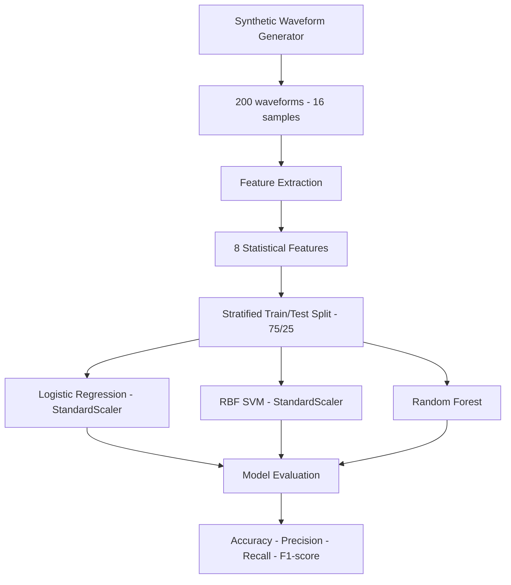

# System Architecture

## Synthetic ZnO MOV Machine Learning Pipeline

## Pipeline Components

1. **Data generation:** Creates 200 synthetic waveforms with 16 voltage samples each.
2. **Feature extraction:** Calculates eight statistical features from each waveform.
3. **Dataset preparation:** Uses a stratified 75/25 train/test split with a fixed random seed.
4. **Model training:** Trains Logistic Regression, RBF SVM and Random Forest classifiers.
5. **Evaluation:** Reports accuracy, precision, recall and F1-score on synthetic test samples.

## Important Notes

- All demonstration data is synthetic.
- StandardScaler is applied within the Logistic Regression and SVM pipelines.
- Random Forest is trained without feature scaling.
- Reported metrics are illustrative and are not experimental thesis results.
- This architecture does not represent a validated real-world MOV diagnostic system.
