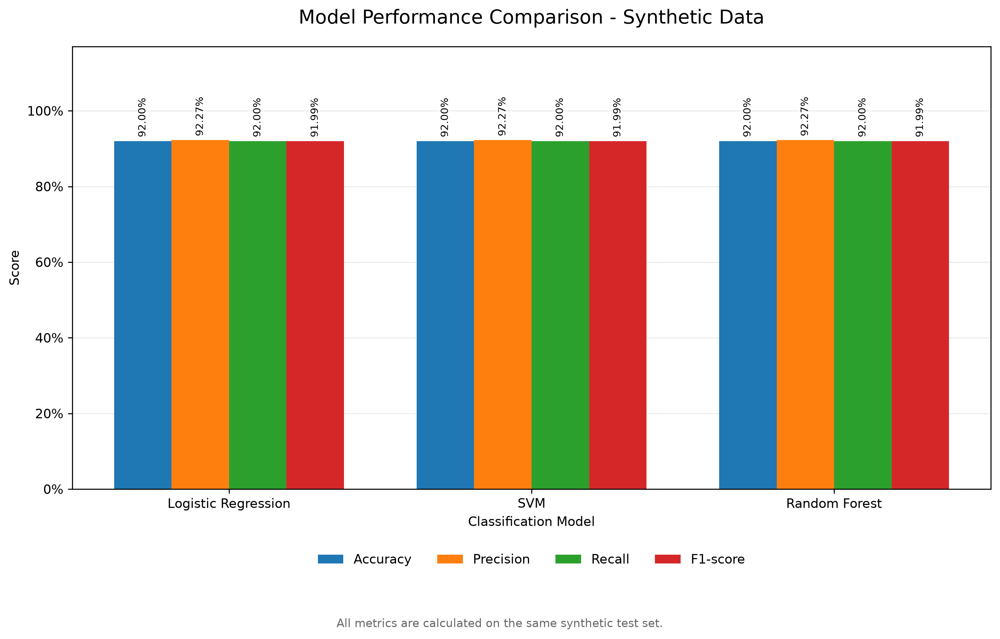
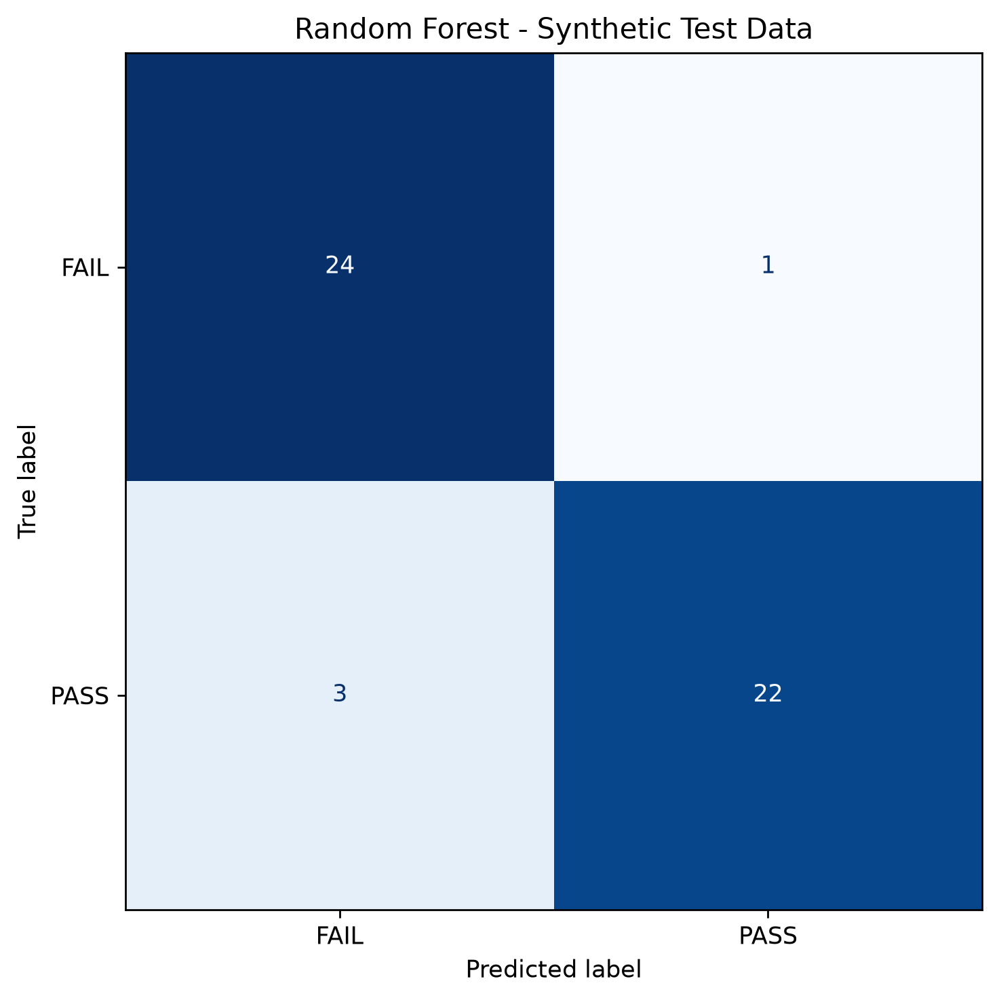
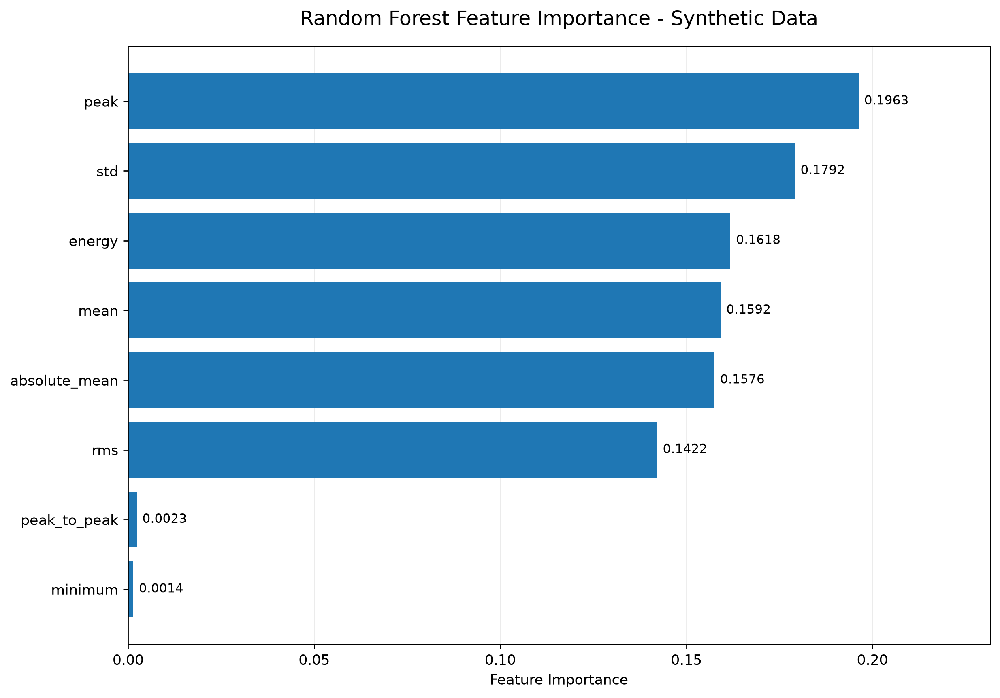

# Synthetic Model Evaluation Results

## 1. Experimental Setup

This document reports the results of the public synthetic ZnO MOV
machine learning demonstration.

The evaluation uses:

- 200 synthetically generated waveforms.
- 16 voltage samples per waveform.
- 8 extracted statistical features.
- Binary classification: PASS / FAIL.
- Stratified 75/25 train/test split.
- Fixed random seed for reproducibility.
- 50 synthetic test samples (25 PASS and 25 FAIL).

These results are illustrative software demonstration results,
not experimental measurements or thesis validation.

## 2. Model Performance Comparison

Three classifiers were evaluated:

- Logistic Regression with StandardScaler.
- Support Vector Machine with RBF kernel and StandardScaler.
- Random Forest without feature scaling.

### Evaluation Metrics

The following metrics represent macro averages across the two classes.

| Model | Accuracy | Precision | Recall | F1-score |
|---|---:|---:|---:|---:|
| Logistic Regression | 0.9200 | 0.9227 | 0.9200 | 0.9199 |
| SVM (RBF) | 0.9200 | 0.9227 | 0.9200 | 0.9199 |
| Random Forest | 0.9200 | 0.9227 | 0.9200 | 0.9199 |

All three models produced identical aggregate metrics on this
particular synthetic test set.

No model superiority can therefore be established from this run.

### Model Comparison



All metrics were calculated on the same synthetic test set.

## 3. Confusion Matrix Analysis

The following confusion matrix illustrates the Random Forest
classification results.



| Actual Class | Predicted FAIL | Predicted PASS |
|---|---:|---:|
| FAIL | 24 | 1 |
| PASS | 3 | 22 |

Interpretation:

- True positives (FAIL): 24.
- False negatives (FAIL predicted as PASS): 1.
- False positives (PASS predicted as FAIL): 3.
- True negatives (PASS): 22.

The results correspond to 46 correct predictions out of 50
synthetic test samples.

The distinction between missed failures and false alarms is
important when considering engineering diagnostic applications.

The confusion matrices for the other classifiers are also
available in the figures directory.

## 4. Feature Importance Analysis

Random Forest feature importance was calculated from the
trained synthetic-data classifier.

| Feature | Importance |
|---|---:|
| peak | 0.1963 |
| std | 0.1792 |
| energy | 0.1618 |
| mean | 0.1592 |
| absolute_mean | 0.1576 |
| rms | 0.1422 |
| peak_to_peak | 0.0023 |
| minimum | 0.0014 |



The peak feature has the highest importance in this particular
synthetic experiment.

These values represent model-specific feature importance,
not causal relationships or experimentally established
physical indicators of MOV degradation.

## 5. Technical Observations

The three classifiers achieved identical aggregate performance
on the generated test set.

This is consistent with a simplified classification problem
where class-dependent waveform amplitude differences can be
captured by multiple statistical features.

Several features are also related to waveform amplitude and
may contain overlapping information.

The results demonstrate the execution of a complete
feature-engineering and classification workflow.

They do not establish generalization to real-world MOV data.

## 6. Research Limitations

The following limitations must be considered:

- All public demonstration waveforms are synthetic.
- The synthetic signals are simplified damped sinusoidal curves
  with random noise and class-dependent amplitude.
- The test samples originate from the same synthetic generator
  as the training samples.
- The evaluation does not establish independent generalization
  to experimentally measured MOV waveforms.
- Feature importance is specific to the trained Random Forest
  model and synthetic dataset.
- No real-world diagnostic deployment or protection capability
  is claimed.

The original experimental datasets, trained thesis models,
simulation artifacts and confidential thesis outputs are
not included in this repository.

The original thesis evaluation also reused some FAIL sample
identities across dataset partitions. Its results should not
be interpreted as a fully independent generalization test.

## 7. Reproducibility

From the repository root, run:

```bash
python src/generate_synthetic_data.py
python src/train_models.py
python src/evaluate_models.py
